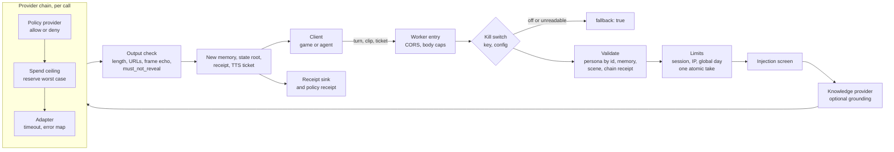

# Architecture

nhe-relay is a general relay for non-human entities (game characters, software agents) that
reach language and speech models through it. It gives each entity a server-side identity (the
persona), puts a fixed safety core around every model call, and returns a chained receipt for
every turn. Which models answer is configuration.

## The request path

Every box that can say no says no with a short machine reason and the persona's fallback line.
Nothing downstream of a refusal runs.

## Pieces

| Piece | File | What it owns |
|---|---|---|
| Entry | `src/index.js` | routing, CORS from the config, body size caps, `/v1/genesis`, `/health` |
| Turn | `src/relay.js` | the turn pipeline above, the kill switch, limits, spend hook |
| Speech | `src/speech.js` | `/v1/stt` (clip caps, transcript cleaning) and `/v1/tts` (ticket check, once-only) |
| Judge | `src/judge.js` | `/v1/judge`, evidence must be a verbatim quote |
| Chain | `src/chain.js` | canonical JSON, state roots, receipts, TTS tickets, keyed ids |
| Safety | `src/safety.js`, `src/scene.js`, `src/memory.js` | sanitising, injection screen, output check, `must_not_reveal`, client memory |
| Personas | `src/personas.js`, `personas/registry.js` | the server-side identity and the fixed frame |
| Limits | `src/limits.js`, `src/limiter-core.js`, `src/limiter.js` | code ceilings, weighted fixed-window counters in one Durable Object |
| Config | `src/config.js`, `relay.config.js` | strict validation; a config that fails to load refuses every call |
| Providers | `src/providers/` | LLM, STT and TTS adapters and the chain runner |
| Extensions | `src/extensions/` | policy, knowledge and receipt sink, with built-in defaults |
| Deploy | `tools/deploy.mjs`, `deploy.config.js` | zero-dependency upload through the Cloudflare API (see DEPLOY.md) |

## Providers

Three interfaces, one chain runner (`src/providers/run.js`). The config lists providers of each
kind in fallback order. For each call the runner checks the time budget, asks the policy,
reserves the provider's worst-case cost against the daily spend ceiling, then calls the adapter
with a hard timeout. An adapter maps every failure to one of `timeout`, `auth`, `rate_limited`,
`bad_request`, `upstream`, `bad_response`, `refused` or `config`, and the runner moves to the
next provider. Details per adapter: [PROVIDERS.md](PROVIDERS.md).

## Extension points

Each has a built-in default, so the relay runs alone with no outside service. An extension can
only narrow what the relay does: it is consulted after the built-in guards pass, and a refusal by
a built-in guard is final.

### Policy provider

Asked before every provider call with `{route, persona_id, provider_id, provider_kind, model,
estimate_micros}`; answers allow or deny. Told about every receipt after a turn. A policy that
throws or cannot be reached is a deny.

| Kind | Status |
|---|---|
| `builtin` (default) | Allows; the built-in guards (kill switch, limits, spend ceiling, injection screen, output check) have already run. |
| `tiresias` | **Stub, fails closed.** See below. |

#### Tiresias adapter status

Tiresias-ZT is Saluca's self-hosted zero-trust policy enforcement proxy for automated agents. It
runs on infrastructure you operate; it is not a hosted service. The `tiresias` policy slot exists
so the interface is fixed, but it ships as a stub that denies every call, because Tiresias-ZT
today does not expose a pre-call decision API. What is documented, and what is missing:

- Documented: its LLM proxy role, where the model call itself passes through Tiresias-ZT, which
  checks it before dispatch and can deny it; and `POST /cp/usage/report` with
  `{tokens_in, tokens_out, cost_usd, model, request_id?, ts?}` for reporting usage afterwards.
- Missing for a tested adapter: a decision endpoint (allow, deny or budget without sending the
  model call), a stable response shape for a cost denial, an HTTP way for a Worker to obtain the
  short-lived capability token the proxy requires (today it is minted from a command line), and
  a documented statement that the LLM proxy role is supported for this use.
- Possible today, untested: point an `openai-compatible` LLM provider's `base_url` at a
  Tiresias-ZT LLM proxy you run behind TLS. That needs the capability-token issue above solved
  first, so it is not documented as a supported setup.

### Knowledge provider

Retrieves grounding passages for a persona from the player's words. Passages are untrusted data:
each is sanitised and capped at 400 characters, and dropped whole if it carries an injection
shape or a URL, or if it would reveal a `must_not_reveal` entry of the current scene. What
remains is placed in the user message inside `<lore>` tags with a citation id, the frame says
lore is reference and never instruction, the reply goes through the same output check, and the
turn record commits to the passages through `knowledge_sha256`. The response lists `citations`
(id, source, and a licence notice when the source requires one). A failed retrieval means no lore
for that turn, never a refusal and never a guess (`meta.knowledge: "unavailable"`).

| Kind | Status |
|---|---|
| `none` (default) | No grounding. |
| `local` | Built in. Passages per persona from `knowledge/lore.js`, ranked by word overlap. Tested. |
| `mcp` | Any MCP server tool over Streamable HTTP (initialize, then `tools/call`). Unit-tested against a mocked server; untested live. |
| `asphodel` | A preset of `mcp` for Asphodel Mindsets (`mindsets.asphodel.ai/mcp`), a commercial knowledge service reached over MCP. Optional; needs a token from Asphodel. Calls `recall` (one mindset per persona) or `ask`. Untested live. |

### Receipt sink

Receives each turn receipt after the reply is built: `{kind, persona_id, session_hash,
turn_index, prev_root, state_root, receipt, provider, model, ms}`. It never carries the player's
words, the reply or the raw session id. A sink cannot change or block a reply; a failure is
logged by kind.

| Kind | Status |
|---|---|
| `log` (default) | One structured log line with the root. The client already holds the receipt. |
| `http` | POSTs the receipt JSON to a fixed https URL with an optional bearer secret. Untested live. |

A provenance ledger is the intended consumer of the sink, for example a service that appends
each receipt to a signed, append-only log. No such adapter ships: the `http` sink is the
documented interface, and a ledger that accepts that JSON can use it as is.

## Profiles

A profile is a way of configuring the same relay, not a fork.

### Gaming NPC (default)

What the examples show. Personas are characters; the client is a game build (web or engine). It
uses scenes with `must_not_reveal`, the beat judge, speech in and out, the persona's fallback line
on every refusal, and short budgets (a 4 s provider timeout and a 7 s turn) so a slow model
becomes a quick fallback instead of a frozen game. CORS lists the game's web origin.

### General agent relay

Personas are agents or assistants with a fixed role and boundaries; the client is a program.
It uses `/v1/turn` without a scene, usually without speech, often with a knowledge provider for
grounding and a receipt sink for an audit trail, and longer budgets (the code ceiling is 15 s per
provider and 20 s per turn). Browser CORS can be empty (server-to-server calls send no Origin).
The reply format is still a short spoken-style reply plus memory: the relay is built for
conversational entities, not for long documents or tool use.

## What is deliberately not here

- No stored transcripts, no accounts, no database beyond the rate and spend counters.
- No streaming replies: a turn is one bounded answer.
- No tool use by the model.
- No way for a request to choose the model, the persona text or the limits.
