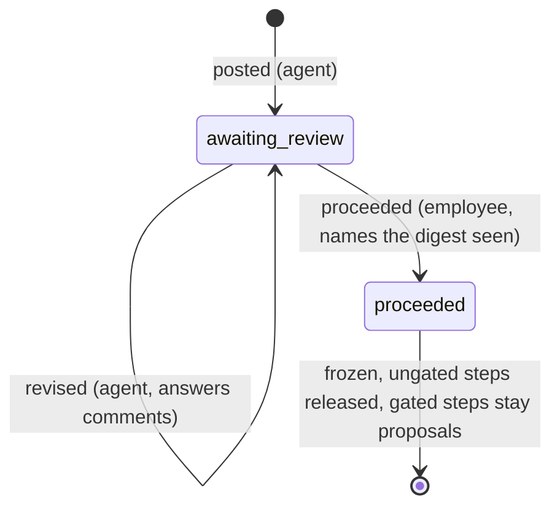

# T3.07 - Commentable plans (D21 item 2)

Before work starts, the agent posts a plan the employee can comment on inline. Every comment,
every agent revision and the employee's Proceed is a new sealed plan revision in the plan's
hash chain. Proceed releases only ungated steps, and the plan lists from revision 0 which
steps will become proposals, a decision card each.

Code: `src/harness/plan.js`. Tests: `test/plan.test.js`. Planted faults: the `plan P1` to
`plan P8` entries in `tools/guard-mutations.mjs`.

## Lifecycle



## Rules enforced in code

| # | Rule | Where | Planted fault |
|---|---|---|---|
| 1 | Every step names an action. `read search analyze edit test draft` are ungated; `send publish schedule deploy push merge delete pay file submit external_write queued_action` are gated. Anything else is refused, never defaulted. | `classifyAction` | P1 |
| 2 | The agent may mark an ungated step gated (narrow), never a gated action ungated (widen). | `normaliseSteps` | P2 |
| 3 | Every gated step is listed in `proposals` from revision 0; `proposalCards()` gives one card stub per gated step, bound to the plan digest. A re-signed revision whose proposals omit a gated step does not verify. | `proposalsOf`, `verifyPlanRevision` | P8 |
| 4 | Comment and Proceed must come from the plan's employee; post and revise from the plan's agent entity. | `applyEvent` | P6 |
| 5 | Proceed names the digest of the revision the employee saw: a stale Proceed is refused, and so is a Proceed while any comment is unanswered by a revision. A proceeded plan is frozen. | `applyEvent` | P4, P5 |
| 6 | Proceed releases only ungated steps. `mayExecute(plan, step)` is true only for an ungated step of a proceeded plan. | `releasedSteps`, `mayExecute` | P3 |
| 7 | The whole history replays from genesis: every root, digest, receipt, `prev_digest` link and derived state is recomputed. A dropped, reordered or re-rooted revision is refused. | `verifyPlanHistory` | P7 |

## Chain

```
root_0 = nextRoot(genesis(entity_id, "plan/" + task_id), event_0)
root_n = nextRoot(root_{n-1}, event_n)
digest_n = SHA-256(canonical({kind: "nhe-relay/plan", ...revision_n without digest}))
receipt_n = HMAC(RELAY_HMAC_KEY, {entity_id, session_hash: digest_n, tool: "plan", outcome: status, ts})
```

`nextRoot`, `genesis` and `canonical` are the turn chain's own functions (`src/chain.js`).
Each revision carries its event, so the state is a pure replay of events (`applyEvent`) and
building a revision and verifying one use the same reducer.

## Who calls what

- **Agent, through the harness (MCP):** `soul.plan_post` and `soul.plan_revise`. Identity
  comes from the bearer token, not from the arguments. Both are handled in the relay, not
  forwarded to soul-svc. The relay stores nothing; the caller keeps each revision and receipt.
- **Employee, through the approval surface (D8):** `commentOnPlan` and `proceedPlan`. These
  are deliberately not harness tools (a test asserts the catalog has no comment or Proceed
  tool), so an agent cannot comment on or proceed its own plan through the relay.

## What this does not do yet

- The relay library checks that a comment or Proceed is labelled with the plan's employee id.
  It cannot authenticate the employee; that is the approval surface's job (T3.03, D8 Slack
  and Teams adapters). Until that surface calls `commentOnPlan` and `proceedPlan`, there is no
  employee-facing button in the relay itself.
- Each gated step's proposal is a card stub (`proposalCards`). Turning it into a signed
  decision card is T3.03 and T3.06.

## Red on a planted fault, measured 2026-11-19

Before the MCP wiring existed, `test/plan.test.js` ran 33 tests, 29 pass and 4 fail (the
catalog test and the three MCP tests). That was the red state for the harness side. With the
module in place, `node tools/guard-mutations.mjs` reported, per planted fault:

| Fault | Tests red |
|---|---|
| P1 unmapped action defaults to ungated | 2 |
| P2 agent may ungate a gated action | 1 |
| P3 Proceed releases gated steps | 2 |
| P4 stale Proceed accepted | 1 |
| P5 Proceed with unanswered comments | 1 |
| P6 event accepted from the wrong party | 2 |
| P7 history root check removed | 1 |
| P8 gated step left off the proposals | 5 |

The guard reported "all 33 mutants killed" (the 25 older mutants too). With no fault planted,
the full suite is 388 tests, 388 pass.

## How a person re-checks it

1. `node --test test/plan.test.js` - 33 tests, all pass.
2. `node --test` - the whole suite passes.
3. `node tools/guard-mutations.mjs` - every mutant is killed, including `plan P1` to `plan P8`.
   Each line names a fault and how many tests went red with it planted.
